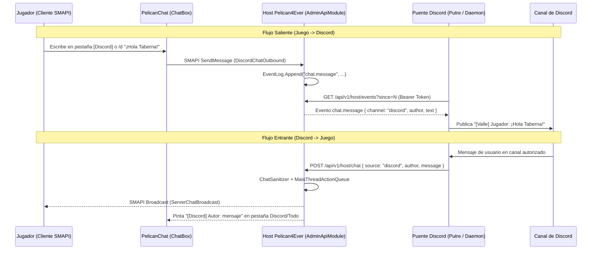

# `architecture.md` — Documento de Arquitectura Técnica (*PelicanChat*)

> **Plataforma verificada:** Stardew Valley **1.6.15** (decompilado con `ilspycmd` sobre `Stardew Valley.dll`) · **SMAPI 4.1+** (probado en 4.5.2) · **Harmony 2.x** · **.NET 6.0 / .NET 8.0 SDK**.
> **Integración objetivo:** **Pelican 4Ever** (`Pelican4Ever.SVRTMP` v0.4.0+) y puente **Hermes / Putre Discord**.

---

## 1. Estructura de la Solución (`.NET`)

Siguiendo el patrón arquitectónico de **Pelican 4Ever** ([ADR-0004](file:///home/mtx/Documentos/Projects/Stardew%20Valley%20MORPG/docs/adr/0004-host-authority-client-mod-and-satiety.md)), la solución separa estrictamente la lógica de dominio pura de las dependencias de MonoGame, XNA, Harmony y SMAPI:

```text
PelicanChat.sln
├── .editorconfig
├── .gitignore
├── global.json                          # .NET SDK 8.0.427
├── local.props.example                  # Plantilla de <GamePath>
├── README.md
├── GSS.md                               # Especificación General del Sistema
├── design.md                            # Resumen de diseño
├── architecture.md                      # Este documento
├── backlog.md                           # Backlog técnico y de producto
├── docs/
│   └── adr/                             # Decisiones de arquitectura (ADR-0001..0003)
├── PelicanChat.Core/                    # Lógica pura (.NET 6, CERO referencias a Stardew/SMAPI/Harmony)
│   ├── Config/
│   │   └── ChatConfig.cs                # Configuración validada (historial, viewport, pestañas, Discord)
│   ├── Channels/
│   │   ├── ChatChannelType.cs           # All, Local, Global, Discord, Whisper, System
│   │   ├── ChatEntry.cs                 # DTO inmutable de entrada en el historial
│   │   ├── ChatRouterLogic.cs           # Análisis de comandos (/l, /g, /w, /d, /r) y ruteo por pestaña
│   │   └── SystemMessageClassifier.cs   # Clasificación de avisos de Pelican4Ever y vanilla
│   ├── Viewport/
│   │   ├── ChatHistoryBuffer.cs         # Buffer circular acotado por canal (200 msgs por defecto)
│   │   ├── ChatTabState.cs              # Estado de pestaña, UnreadCount y ScrollOffset independiente
│   │   └── ChatViewState.cs             # Coordinador de viewport, Scroll Lock y slice visible
│   └── Discord/
│       ├── ChatSanitizer.cs             # Escape de corchetes [color]/[emoji], truncado y limpieza SmallFont
│       └── ExternalChatContract.cs      # DTOs puros para eventos salientes y payloads entrantes
├── PelicanChat/                         # Mod SMAPI (.NET 6, referencia a PelicanChat.Core)
│   ├── manifest.json                    # UniqueID: Pelican4Ever.Chat (sin dependencia dura de Pelican4Ever)
│   ├── ModEntry.cs                      # Registro modular aislado, validación de config y i18n
│   ├── i18n/
│   │   ├── default.json                 # Inglés
│   │   ├── es.json                      # Español
│   │   └── zh-CN.json                   # Chino simplificado
│   ├── Framework/
│   │   ├── IModule.cs
│   │   ├── ModContext.cs
│   │   ├── HarmonyPatchToggle.cs        # Activación/desactivación reversible de parches Harmony
│   │   └── IPelican4EverChatApi.cs      # Interfaz espejo para consumir GetApi() de Pelican4Ever.SVRTMP
│   ├── Integration/
│   │   └── Pelican4EverBridge.cs        # Detección de Pelican4Ever, reloj 1:1 y delegación de canales
│   ├── Patches/
│   │   └── ChatBoxPatches.cs            # Parches Harmony sobre StardewValley.Menus.ChatBox
│   ├── UI/
│   │   ├── ChatTabBarRenderer.cs        # Barra de pestañas y badges sobre el ChatBox
│   │   └── ChatScrollRenderer.cs        # Recorte vertical, scrollbar nativa y píldora "↓ N nuevos"
│   └── Modules/
│       ├── ChatViewModule.cs            # Ciclo de vida de la vista y eventos de teclado/ratón
│       ├── ChatTransportModule.cs       # Red SMAPI autónoma (si Pelican4Ever no está activo)
│       └── DiscordBridgeModule.cs       # Puente saliente/entrante autónomo (Webhook / loopback)
└── PelicanChat.Tests/                   # Suite xUnit (.NET 8) sobre PelicanChat.Core
```

---

## 2. Validación Técnica contra `Stardew Valley 1.6.15` (Decompilado)

Cada punto de extensión se ha verificado sobre el código IL/C# real de `StardewValley.Menus.ChatBox`, `StardewValley.Menus.ChatMessage` y `StardewValley.Game1`:

### 2.1 Entrada por Rueda del Ratón (`Game1.cs` y `ChatBox.cs`)

* **Hallazgo en `Game1.UpdateControlInput` (`Game1.cs:12868-12871`):**
  ```csharp
  if (chatBox != null && chatBox.chatBox.Selected && oldMouseState.ScrollWheelValue != currentMouseState.ScrollWheelValue)
  {
      chatBox.receiveScrollWheelAction(currentMouseState.ScrollWheelValue - oldMouseState.ScrollWheelValue);
  }
  ```
  Y en `Game1.cs:4943-4948` (cuando hay un `childMenu` abierto):
  ```csharp
  if (chatBox != null && chatBox.choosingEmoji && chatBox.emojiMenu.isWithinBounds(getOldMouseX(), getOldMouseY()))
  {
      chatBox.receiveScrollWheelAction(mouseState.ScrollWheelValue - oldMouseState.ScrollWheelValue);
  }
  ```
* **Hallazgo en `ChatBox.receiveScrollWheelAction(int direction)` (`ChatBox.cs:646-652`):**
  ```csharp
  public override void receiveScrollWheelAction(int direction)
  {
      if (choosingEmoji)
      {
          emojiMenu.receiveScrollWheelAction(direction);
      }
  }
  ```
* **Diseño validado:**
  1. `Game1` ya enruta los eventos de rueda del ratón hacia `ChatBox.receiveScrollWheelAction(delta)` mientras el chat está enfocado (`chatBox.Selected`), sin tocar la barra de herramientas.
  2. Un `Postfix` en `ChatBox.receiveScrollWheelAction` que actúe **solo cuando `!__instance.choosingEmoji && direction != 0`** permite desplazar el `ScrollOffset` sin interferir con el selector de emojis.
  3. En `Game1.UpdateControlInput` (`12868`), la llamada ocurre **sin** filtrar por `isWithinBounds`; por tanto, mover la rueda en cualquier lugar de la pantalla con el chat abierto hará scroll en el historial. Si en el futuro se desea scroll incluso sobre `childMenu`, basta añadir un chequeo adicional en `UpdateControlInput` o comprobar coordenadas.

### 2.2 Límites del Menú (`isWithinBounds`) y Clics (`receiveLeftClick`)

* **Hallazgo en `Game1.UpdateControlInput` (`Game1.cs:12912-12929`):**
  Al hacer clic izquierdo, `Game1` recorre `onScreenMenus`:
  - Si `onScreenMenu2.isWithinBounds(x, y)` devuelve `true`, llama a `onScreenMenu2.receiveLeftClick(x, y)` y retorna.
  - Si devuelve `false`, llama a `onScreenMenu2.clickAway()`, lo cual deselecciona `chatBox.Selected = false` y cierra el cuadro de entrada.
* **Hallazgo en `ChatBox.isWithinBounds(int x, int y)` (`ChatBox.cs:421-432`):**
  ```csharp
  if (x - xPositionOnScreen >= width || x - xPositionOnScreen < 0 || y - yPositionOnScreen >= height || y - yPositionOnScreen < -getOldMessagesBoxHeight())
  ```
* **Diseño validado:**
  - `ChatBox` dibuja los mensajes **por encima** de `yPositionOnScreen` (en coordenadas negativas relativas a `yPositionOnScreen`).
  - Al sustituir la altura ilimitada `getOldMessagesBoxHeight()` por una altura visual acotada `EffectiveViewportHeight` (máximo `MaxVisibleHeight = 280px`) más la barra de pestañas superior (`TabBarHeight = 36px`), un `Postfix` en `ChatBox.isWithinBounds` debe ampliar el área aceptada a:
    - `x` en `[xPositionOnScreen, xPositionOnScreen + width]`
    - `y` en `[yPositionOnScreen - EffectiveViewportHeight - TabBarHeight, yPositionOnScreen + height]` (cuando `chatBox.Selected == true`).
  - De este modo, pulsar en una pestaña, en la barra de scroll o en la píldora `"↓ N nuevos"` entra en `ChatBox.receiveLeftClick` (`Prefix`) y **nunca** dispara `clickAway()`.

### 2.3 Interceptación de Entrada de Mensajes y Ruteo Contextual

* **Hallazgo en `ChatBox.textBoxEnter(TextBox sender)` (`ChatBox.cs:133-178`) y `textBoxEnter(string text_to_send)` (`ChatBox.cs:113-131`):**
  - `textBoxEnter(TextBox)` ensambla el texto plano con `ChatMessage.makeMessagePlaintext(chatTextBox.finalText, include_color_information)` (incluyendo el color de jugador `[color]` al final si no empieza por `/`) y llama a `textBoxEnter(string)`.
  - `textBoxEnter(string)` comprueba si `text_to_send[0] == '/'`; si es comando ejecuta `runCommand(text_to_send.Substring(1))`, si no, filtra palabras malsonantes y lo envía a `Multiplayer.AllPlayers`.
* **Diseño validado (sin romper `ChatMessage` ni emojis):**
  - Un `Prefix` en `ChatBox.textBoxEnter(string text_to_send)` intercepta únicamente mensajes **sin `/` inicial** cuando la pestaña activa tiene un canal implícito distinto de `Global` (por ejemplo `Local`, `Discord`, `Whisper` o `System`):
    - Pestaña `Local`: transforma en ejecución de comando `/l <text_to_send>` (reutilizando `ChatCommands` o el puente de `Pelican 4Ever`).
    - Pestaña `Discord`: transforma en `/d <text_to_send>` (canalizando hacia Discord + pestaña `Discord`).
    - Pestaña `Whisper`: transforma en `/r <text_to_send>` (o avisa si no hay `lastReceivedPrivateMessagePlayerId` ni destinatario fijado).
    - Pestaña `Eventos` (`System`): muestra un aviso local informativo (`chat.system_tab_readonly`) en lugar de filtrarlo accidentalmente al chat global.
  - Cuando el usuario escribe explícitamente `/g`, `/l`, `/w`, `/d` o cualquier comando `/evento`, `/residencias`, etc., `text_to_send[0] == '/'` y se respeta al 100% la lógica estándar.

### 2.4 Captura de Mensajes y Prevención del Truncamiento a 10 Elementos

* **Hallazgo en `ChatBox.receiveChatMessage` y `ChatBox.addMessage` (`ChatBox.cs:574-608`):**
  - Ambos construyen un `ChatMessage`, hacen `Game1.parseText(...)`, llaman a `chatMessage.parseMessageForEmoji(...)` y ejecutan `if (messages.Count > maxMessages) messages.RemoveAt(0);`.
* **Diseño validado:**
  - En lugar de reemplazar `ChatBox` o dejar que pierda mensajes, un `Postfix` en `receiveChatMessage` y `addMessage` (o un `Prefix` que evite llamadas recursivas cuando **PelicanChat** inyecta un mensaje con formato propio) captura cada mensaje recién creado, lo clasifica mediante `SystemMessageClassifier` y lo almacena en `ChatViewState` (`MaxHistoryPerChannel = 200`).
  - Se protege contra reentradas mediante un flag `[ThreadStatic]` / `AsyncLocal` o guardia booleana en el hilo principal (`isInternalDispatch`), ya que todas las llamadas de UI ocurren en el hilo del juego.
  - El dibujado (`Prefix` en `ChatBox.draw(SpriteBatch b)`):
    1. Si `chatBox.Selected == false`, dibuja el comportamiento clásico de mensajes recientes con `alpha > 0.01f`, limitado a `MaxClosedHeight` (evita llenar la pantalla si llegan varios avisos seguidos).
    2. Si `chatBox.Selected == true`, reemplaza el dibujado de `messages` por el viewport acotado (`ChatScrollRenderer`), dibuja la barra de pestañas (`ChatTabBarRenderer`), delega el dibujado de `chatBox.Draw(b)`, `emojiMenuIcon` y `emojiMenu` para conservar compatibilidad con el selector de emojis y cursor del juego.

### 2.5 Atajos de Teclado (`ChatBox.receiveKeyPress`, `ChatBox.cs:440-465`)

* `Keys.Up` y `Keys.Down` permanecen intactos navegando por `cheatHistory`.
* `Keys.Tab`: con `KeyboardState.IsKeyDown(Keys.LeftShift) || IsKeyDown(Keys.RightShift)` retrocede pestaña; sin Shift avanza a la siguiente.
* `Keys.PageUp` / `Keys.PageDown`: desplazan una página (`~5` líneas) arriba/abajo.
* `Keys.Home` / `Keys.End` (cuando `LeftControl`/`RightControl` está pulsado, para no robar `Home`/`End` de la edición de texto en `ChatTextBox`): saltan al inicio o al final del historial.

### 2.6 Riesgo de Corchetes en `ChatMessage.parseMessageForEmoji` (`ChatMessage.cs:20-92`)

* **Hallazgo en `ChatMessage.parseMessageForEmoji`:**
  - Cualquier `[n]` con `n < EmojiMenu.totalEmojis` se convierte en un sprite de emoji, y cualquier `[red]`, `[aqua]`, `[yellow]`, etc. cambia el color del mensaje completo si `color == Color.White`.
  - Si un mensaje contiene un `[` sin `]` o tags anidados `[foo [bar]`, el parser puede descartar texto o comportarse de forma inesperada.
* **Solución en `PelicanChat.Core/Discord/ChatSanitizer.cs`:**
  - Todo mensaje procedente de fuentes externas (Discord / API HTTP) pasa por `ChatSanitizer.SanitizeForChatBox(string raw)`:
    - Normaliza saltos de línea (`\r\n`, `\n` $\rightarrow$ espacio o límite controlado).
    - Reemplaza corchetes `[` y `]` de texto externo por paréntesis `(` / `)` o corchetes escapados seguros, impidiendo inyección de tags `[color]` o emojis involuntarios.
    - Convierte menciones Discord (`<@123>`, `<#456>`, `@everyone`) en texto neutro legible o las atenúa.
    - Filtra caracteres Unicode fuera del rango soportado por `SmallFont` (emojis gráficos Unicode $\rightarrow$ tag textual breve o reemplazo seguro).

---

## 3. Arquitectura de Integración con `Pelican 4Ever` y Discord

### 3.1 Detección y Contrato de API (`IPelican4EverChatApi`)

En `ModEntry` (`PelicanChat`), durante `GameLoop.GameLaunched`:

```csharp
var api = Helper.ModRegistry.GetApi<IPelican4EverChatApi>("Pelican4Ever.SVRTMP");
```

Si `api != null && api.IsPelican4EverEnabled()`:
1. **Reloj 1:1:** `PelicanChat` consulta la hora actual del servidor (`GetServerClockSummary()` o lee `Game1.timeOfDay` + estado `IsNightHold`) para etiquetar cada `ChatEntry` con `[HH:mm]`.
2. **No colisión en `ChatCommands`:** `Pelican4Ever` (`ChatChannelModule.cs`) ya registra `/l`, `/local`, `/g`, `/global` y el alias `/w`. `PelicanChat` verifica `ChatCommands.Exists(...)` antes de registrar comandos y, cuando `Pelican4Ever` está activo, delega en `ChatChannelModule` la emisión de `/l` y escucha su tipo de mensaje SMAPI (`LocalChat`) o consume el evento de `IPelican4EverChatApi`.
3. **Clasificador de Eventos de `Pelican 4Ever` (`SystemMessageClassifier`):**
   Identifica determinísticamente mensajes de:
   - **Rollover y Madrugada:** `[Reinicio Controlado]`, avisos de cuenta atrás de las `02:00 AM`, congelación en `2550`.
   - **Festivales (`FestivalParticipationModule` / `FestivalMinigameModule`):** `[Festival]`, `[Ceremonia]`.
   - **Economía (`CommunityMarketModule` / `MailOrderModule` / `TownMailboxModule`):** compras del Tablón de Pierre y entregas de Robin/Clint/Marnie.
   Todos se enrutan a la pestaña `Eventos` (y se replican en `Todo`), marcando `IsCritical = true` cuando corresponden a reinicios o rollover inminente.

### 3.2 Flujo Bidireccional con Discord



### 3.3 Correcciones y Extensiones Necesarias en `Pelican 4Ever` (Puente)

Durante el análisis del repositorio `Stardew Valley MORPG` se han identificado 3 mejoras concretas que deben aplicarse en `Pelican4Ever` para cerrar el puente al 100%:

1. **`P4E-CHAT-01` — Ampliar `PelicanApi.cs`:**
   Exponer `IsModEnabled`, lectura horaria del servidor (`GetClockSnapshot`) y hook de registro/emisión de chat por canal para que `PelicanChat` (u otros mods) consulten el estado sin acoplarse a tipos internos.
2. **`P4E-CHAT-02` — Retransmisión real en `AdminApiModule.BroadcastToAllPlayers`:**
   Actualmente `AdminApiModule.cs:696-710` llama únicamente a `Game1.chatBox?.addMessage(...)` en el proceso del Host (invisible para los clientes cuando corre con `HeadlessRendering` o `DedicatedServerMode`). Debe emitir además un mensaje SMAPI (`ChatMessages.ServerBroadcast`) hacia todos los clientes conectados.
3. **`P4E-CHAT-03` — Endpoint `POST /api/v1/host/chat` y evento `HostEventTypes.ChatMessage`:**
   - Añadir `public const string ChatMessage = "chat.message";` en `Pelican4Ever.Core/Admin/HostEventLog.cs`.
   - Añadir la ruta oficial `POST /api/v1/host/chat` en `Pelican4Ever.Core/Admin/HostApiContract.cs` (y en `docs/host-api.md`, verificando el test de paridad `ExtractDocumentedRoutes`) y su despacho en `AdminApiModule.cs`.

---

## 4. Modo Autónomo (Sin `Pelican 4Ever`)

Cuando `PelicanChat` detecta que `Pelican4Ever.SVRTMP` no está instalado o está desactivado:
1. **Proximidad propia (`ChatTransportModule`):** Registra `/l` (`/local`) y `/g` (`/global`) en `ChatCommands` si no existen, usando un paquete SMAPI bajo `UniqueID = Pelican4Ever.Chat` con cálculo de distancia euclidiana $\le 30$ tiles en la misma ubicación (`GameLocation.NameOrUniqueName`).
2. **Puente Discord ligero opcional (`DiscordBridgeModule`):**
   - Solo activo en el Host (`Context.IsMainPlayer`) y desactivado por defecto (`DiscordBridgeEnabled = false`).
   - **Salida:** Envío HTTP asíncrono no bloqueante (cola en hilo de fondo) hacia `DiscordWebhookUrl` configurado en `config.json` del Host (nunca sincronizado a clientes).
   - **Entrada:** Listener HTTP loopback opcional (`127.0.0.1:<port>`) protegido por Bearer Token local para recibir mensajes de un bot/puente sin necesitar `Pelican4Ever`.
